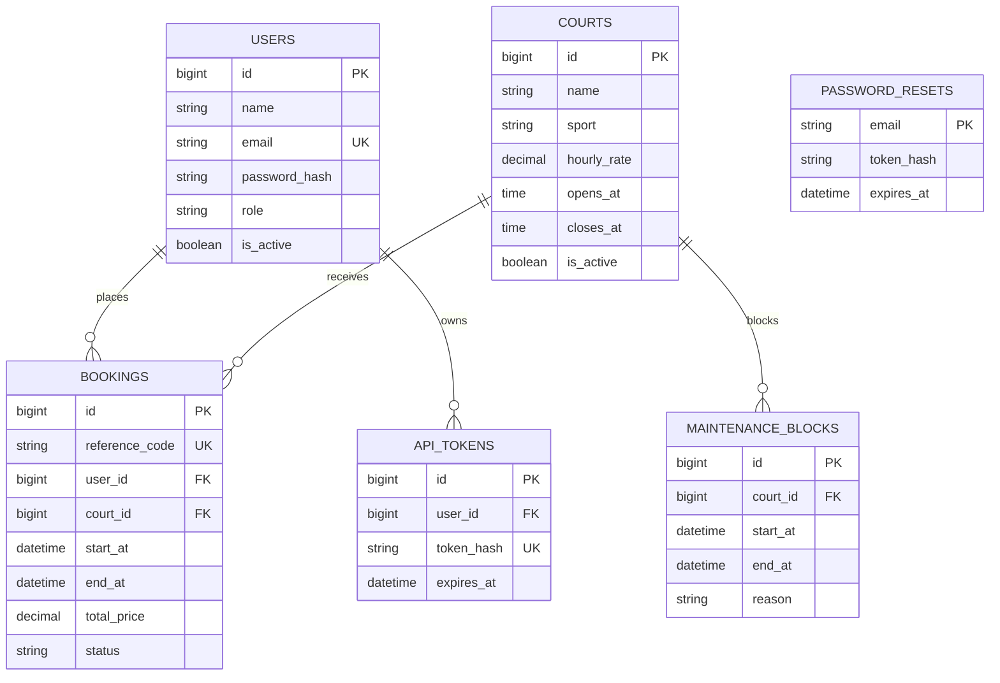

# Database design

All tables use InnoDB and `utf8mb4`. `bookings` keeps restrictive user/court foreign keys to preserve history; a court is deactivated rather than hard-deleted. The court/window indexes support overlap checks. API tokens and password reset links are stored as SHA-256 hashes. Booking status is constrained to the lifecycle values. Imported tables are defined in `database/schema.sql`.
